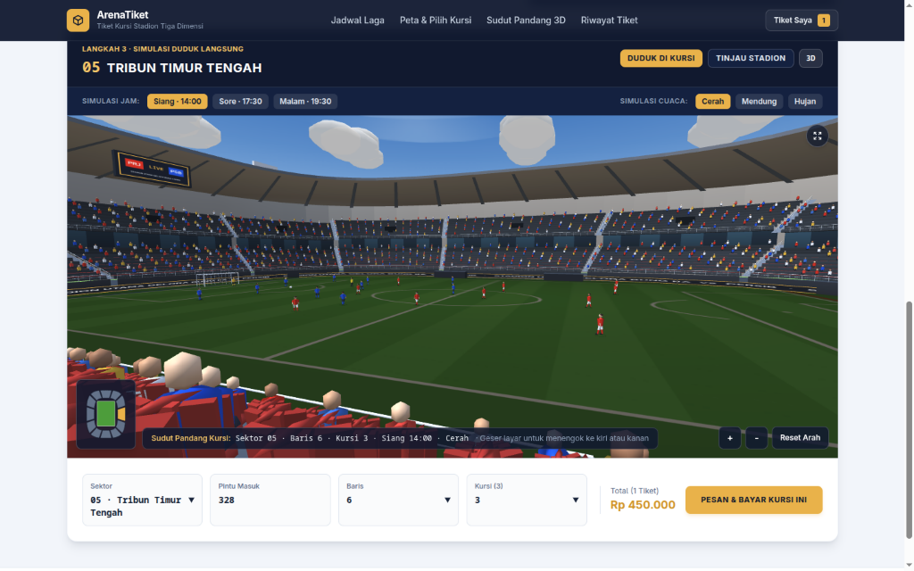
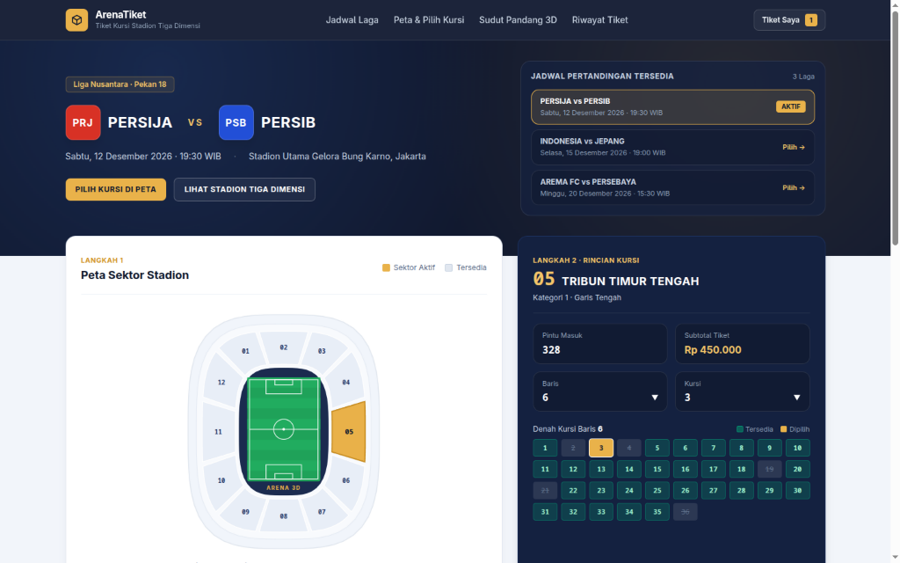
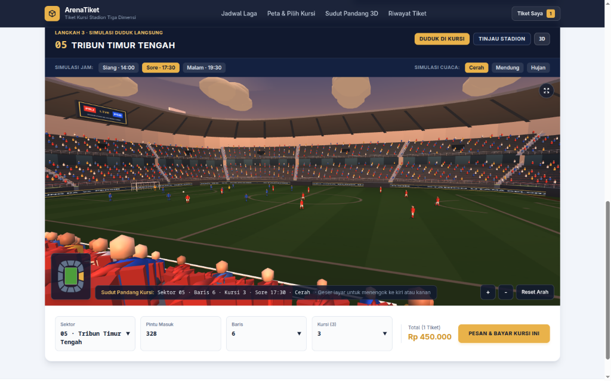
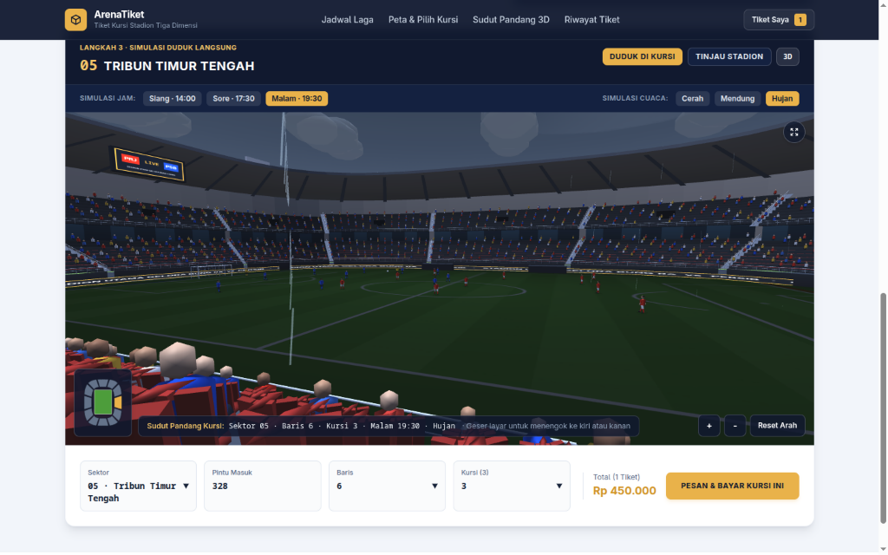
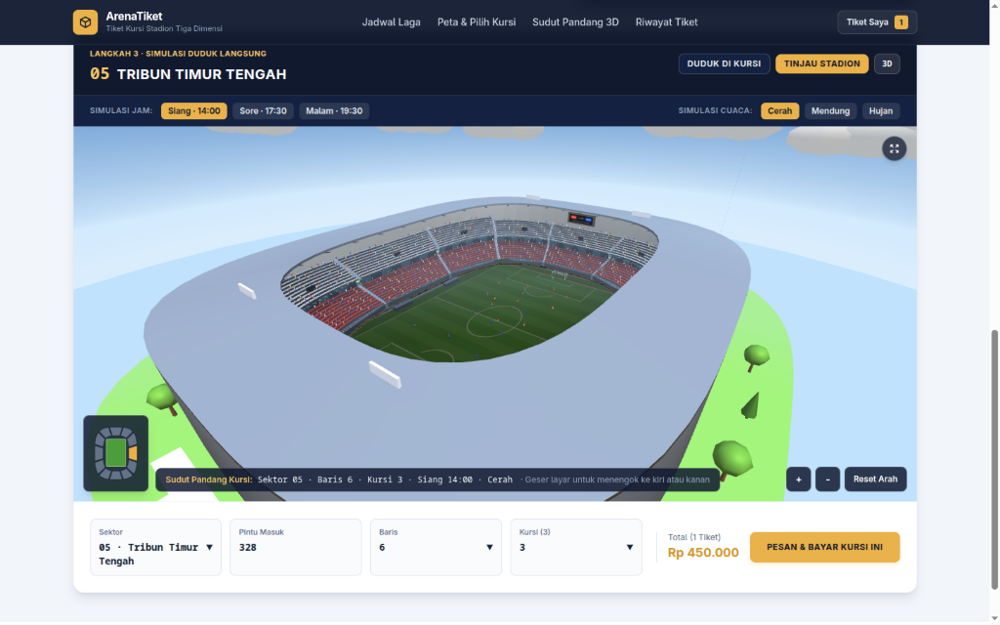
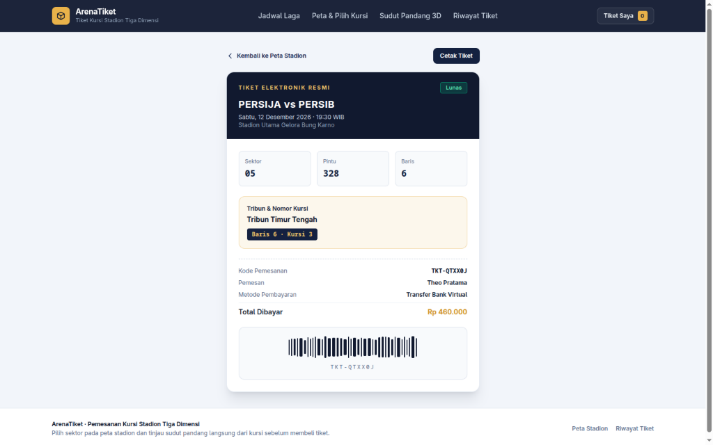
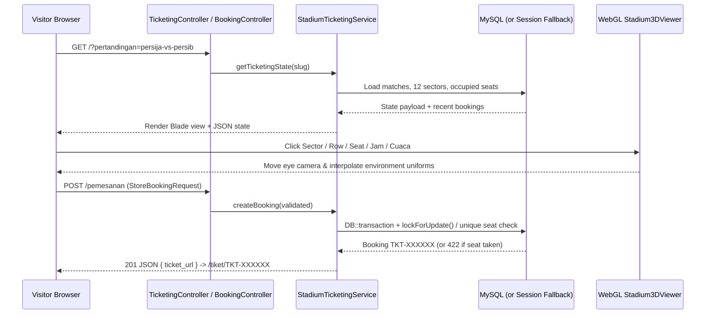

<p align="center">
  
</p>

<h1 align="center">ArenaTiket</h1>

<p align="center">
  <b>Sit in your stadium seat before you buy the ticket.</b><br/>
  Interactive 3D stadium ticketing on Laravel 13 and pure WebGL: pick any sector on the top-down bowl map, step straight into eye-level Seat POV with a live 11-vs-11 match on the pitch, and preview your view across afternoon sun, sunset, and night rain before issuing your e-ticket.
</p>

<p align="center">
  
  
  
  
  
  
  
</p>

---

ArenaTiket is for **football supporters and stadium operators who want zero guesswork when choosing a seat**: the fan comparing a low row behind the north goal against an elevated midfield seat, the evening matchgoer checking whether sunset glare hits the east stand, or the developer showcasing full-stack Laravel concurrency alongside real-time 3D graphics without adding third-party 3D libraries.

> **Do not buy blind from a 2D sector block. Sit in the seat first.**
>
> - **1-to-1 coordinate geometry:** All 12 sectors (`01` to `12`) on the top-down SVG map and inside the 3D bowl share the exact same continuous superellipse contour (`p = 3.4`).
> - **True eye-level Seat POV:** Switching sectors, rows (`1–22`), or seat numbers moves the 3D camera directly to that seat's `(x, y, z)` elevation across the lower bowl and overhanging upper tier, surrounded by contoured 3D seats and silver stairway handrails.
> - **Time-of-day and weather preview:** Toggle **Siang (14:00)**, **Sore (17:30)**, or **Malam (19:30)** with **Cerah**, **Mendung**, or **Hujan** to inspect glare, floodlights, and 3D rain streaks from that exact seat.
> - **Double-booking guard:** Seat reservations run inside a database transaction (`lockForUpdate` plus a unique `(stadium_match_id, sector_code, row_number, seat_number)` constraint) when MySQL is active, with an automatic session fallback when running without a database daemon.


<p align="center"><sub>Live 3D Seat Point-of-View from Sector 05, Row 6, Seat 3: contoured 3D seats, handrails, overhanging upper balcony, crowd, 3D clouds, mini-map inset, and animated 11-vs-11 match demo.</sub></p>

---

## Try it in 2 minutes

Every step is "do X, see Y" once the local Laravel server is running at `http://127.0.0.1:8000`.

| # | Do | See |
|---|---|---|
| 1 | Open **`http://127.0.0.1:8000`** | Match hero (`PERSIJA vs PERSIB`), quick switcher for 3 fixtures, and the 12-sector top-down stadium map paired with the Sector `05` seat panel |
| 2 | Drag the **Price Range Slider** or click any sector (`01`–`12`) on the SVG map | Out-of-range sectors dim automatically; the selected sector highlights in gold and updates gate, row, seat strip, and subtotal |
| 3 | Scroll to **Langkah 3 · Simulasi Duduk Langsung** and drag inside the 3D canvas | Real-time WebGL view straight from your selected seat with smooth damped look-around, animated 22 players + referee, and a clickable mini-map inset |
| 4 | Click **Sore · 17:30**, **Malam · 19:30**, or **Hujan** | Smooth sky, sun-angle, and floodlight transition, plus falling 3D rain streaks and wet pitch reflections |
| 5 | Click **Tinjau Stadion** (or the top-right fullscreen icon) | Aerial diorama overview of the entire stadium, park perimeter, trees, and your active sector highlighted in gold |
| 6 | Click **Pesan & Bayar Kursi Ini**, fill buyer details, and submit | Issued e-ticket (`/tiket/TKT-...`) with deterministic entry barcode; returning to that row immediately marks the booked seat as `Terjual` |

---

## What Makes ArenaTiket Different

### Who This Is For

Meet **Raka**. Raka wants to buy two tickets for a big weekend derby at Gelora Bung Karno. Every ticketing site shows him a flat oval labeled `Sector 05` and `Sector 02`, a price tag, and a dropdown of row numbers. He has no idea if Row 6 behind the north goal leaves the far penalty box blocked by the crossbar, whether the 17:30 sun shines straight into the east stand, or how steep the overhanging upper balcony feels.

Raka does not want a static stock photo taken from someone else's row. He wants to click his seat, look left and right from it, test the sunset and rain, and check out knowing exactly what he paid for.

---

### The Problem

- **Flat 2D seat maps hide sightlines**: row numbers tell you nothing about elevation, roof overhang, handrails, or goalpost obstruction
- **Static "view from section" photos lie**: one generic photo for an entire stand misses the difference between Row 2 pitch-side and Row 20 upper deck
- **Kickoff conditions change visibility**: an east-stand seat feels completely different at 14:00 noon, 17:30 sunset glare, and 19:30 under floodlights or heavy rain
- **Heavy 3D libraries bloat simple college/web stacks**: pulling massive external 3D bundles or remote model files breaks offline demos and slows page loads
- **Concurrent seat picks collide**: two fans clicking the same seat without transactional locking produce duplicate tickets

**How might we let supporters sit inside their exact seat—under sun, sunset, or rain—before paying a rupiah?**

---

### The Solution

ArenaTiket pairs a responsive Laravel 13 website with a zero-dependency WebGL 3D stadium engine. Five pieces.

**1. Shared contour geometry across 2D and 3D.** `StadiumCatalogData` defines all 12 sectors with continuous angles (`-45°` to `315°`). Both the SVG wedge map (`resources/js/app.js`) and the 3D bowl (`resources/js/stadium-3d.js`) evaluate the same `p = 3.4` superellipse contour, so clicking Sector `02` or Sector `11` aligns 1-to-1.

**2. Eye-level Seat POV with real foreground architecture.** Changing `Sektor`, `Baris`, or `Kursi` moves the damped camera smoothly to `(x, y + 1.42m, z)` inside a two-tier bowl featuring curved 3D seats around your position, silver stairway handrails, an overhanging upper balcony, VIP glass skyboxes, and dark vomitory tunnels.

**3. Live time-of-day and weather shaders.** Fragment-shader uniforms interpolate sky dome gradients, sun direction, cloud tint, stadium floodlights, wet turf specular highlights, and dynamic 3D rain streaks in real time across 9 time-and-weather combinations.

**4. Animated 11-vs-11 match and stadium crowd.** Instead of an empty pitch, 22 articulated cylindrical-and-spherical players, 1 referee, and a bouncing ball play continuously while spectators populate all 12 sectors, keeping your immediate seat neighborhood clear.

**5. Transactional booking with offline resilience.** `StadiumTicketingService` persists bookings inside `DB::transaction` with `lockForUpdate()` when MySQL tables exist, and seamlessly falls back to session-backed reservations (`SESSION_DRIVER=file`) if the local MariaDB service is offline.

---

## Visual Tour & Features


<p align="center"><sub>Match hero, 3-fixture switcher, interactive 12-sector SVG stadium map with price range filter, and Sector 05 seat availability strip.</sub></p>

- **Interactive Match & Sector Picker**: Filter sectors in real time using the dual-thumb Rupiah price slider (`Rp 175.000`–`Rp 850.000`), choose 1–4 adjacent seats, and click individual seats directly in the row strip
- **Live 11-vs-11 Animated Match Demo**: Smooth articulated players (spherical heads, tapered torsos, swinging limbs) and a referee move dynamically across a 2048x2048 procedural grass pitch with scrolling LED boards and dual Jumbotron scoreboards


<p align="center"><sub>Time-of-Day simulation: Sore 17:30 casts golden-amber sunset light across the upper bowl, clouds, and opposite stands.</sub></p>


<p align="center"><sub>Night and Rain simulation (Malam 19:30 · Hujan): stadium floodlights ignite, rain streaks fall across the bowl, and the pitch surface reflects wet highlights.</sub></p>

- **Aerial Stadium Diorama & Mini-Map**: Toggle **Tinjau Stadion** to inspect the entire sunlit stadium island, low-poly park trees, and gold-highlighted sector, or click sectors straight from the bottom-left mini-map inset inside fullscreen mode


<p align="center"><sub>Aerial overview ("Tinjau Stadion"): multi-tier bowl, exterior park, trees, drifting 3D clouds, and active Sector 05 highlight.</sub></p>

- **Printable Electronic Ticket & History**: Completing checkout validates buyer input via `StoreBookingRequest`, blocks double-booking, and generates `/tiket/{bookingCode}` with a deterministic barcode and print layout


<p align="center"><sub>Electronic Ticket view (`/tiket/TKT-QTXX0J`): gate, row, seat summary, payment breakdown, and print-ready barcode.</sub></p>

---

## Tech Stack

| Layer | Technology | Where |
|---|---|---|
| **Backend & Routing** | Laravel 13 (`^13.17`), PHP 8.3+ | `app/Http/Controllers/`, `app/Services/`, `routes/web.php` |
| **Database & Schema** | MySQL / MariaDB, Eloquent ORM, 4 Migrations | `database/migrations/`, `app/Models/` |
| **Frontend & Styling** | Blade Templates, Tailwind CSS v4 (`@tailwindcss/vite`), Vite 8 | `resources/views/`, `resources/css/app.css` |
| **3D Graphics Engine** | Custom Pure WebGL1 + GLSL Shaders + Procedural Canvas Textures | `resources/js/stadium-3d.js` |
| **UI State & SVG Map** | Modular Vanilla ES Modules | `resources/js/app.js` |
| **Quality & Testing** | PHPUnit 12, Laravel Pint | `tests/Feature/StadiumTicketingTest.php` |

---

## Architecture



---

## Setup & Running Locally

### Requirements

- **PHP 8.3+** (with `pdo_mysql` or `file` session support)
- **Composer** and **Node.js 20+** (`npm`)
- **MySQL / MariaDB** *(optional; the app runs cleanly via session storage if MySQL is stopped)*

### Installation & Development

```bash
git clone https://github.com/mytheos/PWL-ANCOK.git
cd PWL-ANCOK
git checkout dev-theo-testing-ui

composer install
cp .env.example .env
php artisan key:generate

npm install
npm run build
```

If you want persistent MySQL storage, start MariaDB/MySQL, verify `.env` credentials (`DB_DATABASE`, `DB_USERNAME`, `DB_PASSWORD`), and run:

```bash
php artisan migrate --seed
```

Start the local server (if your PHP CLI enables `opcache.enable_cli=1`, disable CLI opcache during development so Blade edits reflect immediately):

```bash
php -d opcache.enable=0 -d opcache.enable_cli=0 artisan serve --host=127.0.0.1 --port=8000
```

### Run Tests & Code Style Check

```bash
vendor/bin/pint --dirty --format agent
php artisan test --compact
```

---

## Repository Layout

```
miniproject/
├── .github/assets/              SVG logo mark & README screenshots
├── app/
│   ├── Http/Controllers/        TicketingController & BookingController
│   ├── Http/Requests/           StoreBookingRequest validation rules
│   ├── Models/                  StadiumMatch, StadiumSector, Booking, BookedSeat
│   ├── Services/                StadiumTicketingService (DB transaction + fallback)
│   └── Support/                 StadiumCatalogData (matches, 12 sectors, seed seats)
├── database/
│   ├── factories/               StadiumMatchFactory
│   ├── migrations/              Matches, sectors, bookings, booked_seats tables
│   └── seeders/                 DatabaseSeeder & StadiumSeeder
├── resources/
│   ├── css/app.css              Tailwind v4 theme tokens & range slider styling
│   ├── js/stadium-3d.js         Pure WebGL 3D stadium, players, clouds & weather engine
│   ├── js/app.js                2D SVG map, seat strip, checkout modal & 3D sync
│   └── views/                   Layouts, main ticketing page, e-ticket & history views
├── routes/web.php               Web routes (`/`, `/tiket`, `POST /pemesanan`, `/tiket/{code}`)
└── tests/Feature/               StadiumTicketingTest (6 tests, 29 assertions)
```

---

## Limits, Stated Plainly

- **Simulated payment only**: checkout validates buyer fields and payment method selection (`Transfer Bank Virtual`, `Dompet Digital`, `Kartu Debit atau Kredit`), then immediately issues a paid ticket without integrating an external payment gateway.
- **Session fallback vs MySQL**: when the local MariaDB service is inactive, new reservations persist in the browser session (`SESSION_DRIVER=file`) rather than across browsers; starting MariaDB and running `php artisan migrate --seed` enables shared transactional MySQL persistence.
- **Procedural 3D geometry**: players, spectators, seats, and clouds are built procedurally in `stadium-3d.js` using smooth WebGL cylinders and spheres so the app requires zero external 3D asset downloads or extra npm packages.
- **No admin CRUD UI yet**: fixtures and sector pricing are seeded from `StadiumCatalogData` and `StadiumSeeder`.

---

## License

[MIT](https://opensource.org/licenses/MIT) (as declared in [composer.json](composer.json)).

> **Pick the sector. Sit in the row. Check the sunset and rain before you pay.**
